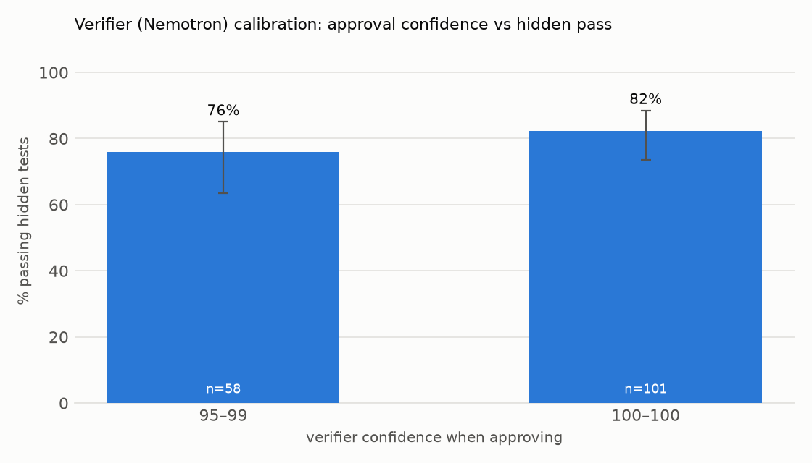

# Verifier calibration (proof_of_done, 168 tasks where the verifier ran)

Final verifier verdict vs hidden tests (the verifier never sees hidden tests).

| verifier verdict | hidden pass | hidden fail | precision |
|---|---|---|---|
| approve | 127 | 32 | 80% of approvals were right |
| reject | 5 | 4 | 44% of rejections were right |

| confidence | n | hidden pass rate (95% CI) |
|---|---|---|
| approve 95-99 | 58 | 76% (63%–85%) |
| approve 100-100 | 101 | 82% (74%–88%) |

