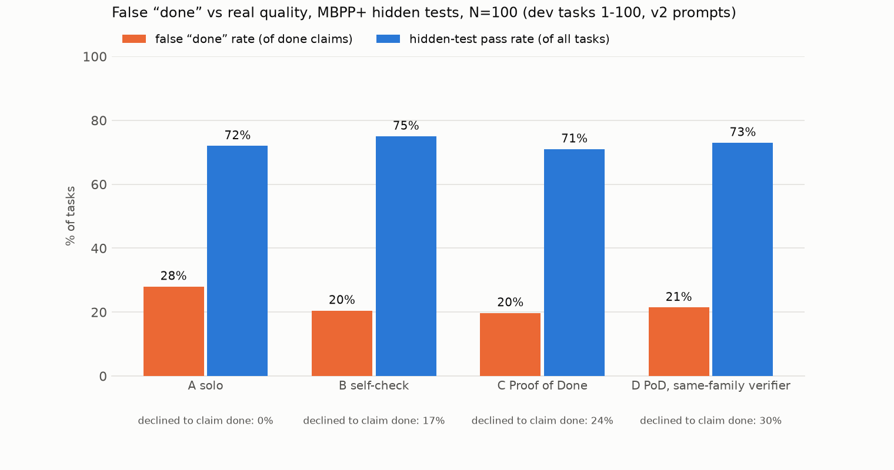
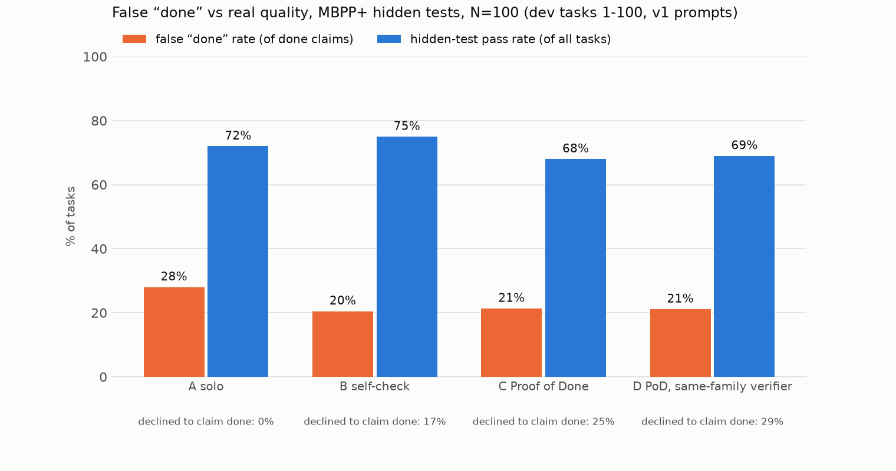

# Proof of Done: evaluation results

Headline = held-out split (tasks 101-200, never used for tuning). Chart: [chart.png](chart.png).

## Results: held-out tasks 101-200

MBPP+ (evalplus), N=100 tasks (seeded order 101-200), seed 17. Agents see only the task prompt; hidden tests = differential testing against `canonical_solution` on base + plus inputs.

- **false done rate** = claimed done AND failed hidden tests / done claims
- **hidden pass** = final code passes hidden tests / all tasks (regardless of claim)
- **not done** = the system declined to claim done (Proof of Done asks the human one question)

| condition | N | done claims | false done | false done rate (95% CI) | hidden pass | not done | calls/task | tokens/task | s/task |
|---|---|---|---|---|---|---|---|---|---|
| A solo | 100 | 100 | 32 | 32.0% (24%–42%) | 68% | 0% | 1.0 | 323 | 1.2 |
| B self-check | 100 | 89 | 24 | 27.0% (19%–37%) | 69% | 11% | 2.5 | 2,768 | 4.8 |
| C Proof of Done | 100 | 80 | 17 | 21.2% (14%–31%) | 75% | 20% | 5.3 | 6,477 | 21.4 |
| D PoD, same-family verifier | 100 | 76 | 14 | 18.4% (11%–29%) | 76% | 24% | 5.6 | 6,971 | 6.4 |

- Proof of Done mutation kill rate: 89% before test strengthening, 97% after (tests strengthened on 29/100 tasks).
- A solo: 68% of tasks ended with a *correct* done claim.
- C Proof of Done: 63% of tasks ended with a *correct* done claim.
- Of the 32 tasks where solo falsely claimed done, Proof of Done **fixed 10** (done + passes hidden tests), **declined 9** (asked the human), and still falsely claimed 13 (12 of those no condition passes).
- Regressions: 5 tasks where solo's code passes hidden tests but Proof of Done's final code does not.

## Results: all 200 tasks, v2 prompts

MBPP+ (evalplus), N=200 tasks (seeded order 1-200), seed 17. Agents see only the task prompt; hidden tests = differential testing against `canonical_solution` on base + plus inputs.

- **false done rate** = claimed done AND failed hidden tests / done claims
- **hidden pass** = final code passes hidden tests / all tasks (regardless of claim)
- **not done** = the system declined to claim done (Proof of Done asks the human one question)

| condition | N | done claims | false done | false done rate (95% CI) | hidden pass | not done | calls/task | tokens/task | s/task |
|---|---|---|---|---|---|---|---|---|---|
| A solo | 200 | 200 | 60 | 30.0% (24%–37%) | 70% | 0% | 1.0 | 328 | 1.9 |
| B self-check | 200 | 172 | 41 | 23.8% (18%–31%) | 72% | 14% | 2.5 | 2,922 | 5.8 |
| C Proof of Done | 200 | 156 | 32 | 20.5% (15%–28%) | 73% | 22% | 5.3 | 6,653 | 24.0 |
| D PoD, same-family verifier | 200 | 146 | 29 | 19.9% (14%–27%) | 74% | 27% | 5.7 | 7,383 | 7.5 |

- Proof of Done mutation kill rate: 89% before test strengthening, 97% after (tests strengthened on 50/200 tasks).
- A solo: 70% of tasks ended with a *correct* done claim.
- C Proof of Done: 62% of tasks ended with a *correct* done claim.
- Of the 60 tasks where solo falsely claimed done, Proof of Done **fixed 12** (done + passes hidden tests), **declined 21** (asked the human), and still falsely claimed 27 (25 of those no condition passes).
- Regressions: 10 tasks where solo's code passes hidden tests but Proof of Done's final code does not.

## Results: dev tasks 1-100, v2 prompts

MBPP+ (evalplus), N=100 tasks (seeded order 1-100), seed 17. Agents see only the task prompt; hidden tests = differential testing against `canonical_solution` on base + plus inputs.

- **false done rate** = claimed done AND failed hidden tests / done claims
- **hidden pass** = final code passes hidden tests / all tasks (regardless of claim)
- **not done** = the system declined to claim done (Proof of Done asks the human one question)

| condition | N | done claims | false done | false done rate (95% CI) | hidden pass | not done | calls/task | tokens/task | s/task |
|---|---|---|---|---|---|---|---|---|---|
| A solo | 100 | 100 | 28 | 28.0% (20%–37%) | 72% | 0% | 1.0 | 333 | 2.6 |
| B self-check | 100 | 83 | 17 | 20.5% (13%–30%) | 75% | 17% | 2.5 | 3,076 | 6.7 |
| C Proof of Done | 100 | 76 | 15 | 19.7% (12%–30%) | 71% | 24% | 5.3 | 6,829 | 26.6 |
| D PoD, same-family verifier | 100 | 70 | 15 | 21.4% (13%–32%) | 73% | 30% | 5.7 | 7,795 | 8.5 |

- Proof of Done mutation kill rate: 88% before test strengthening, 98% after (tests strengthened on 21/100 tasks).
- A solo: 72% of tasks ended with a *correct* done claim.
- C Proof of Done: 61% of tasks ended with a *correct* done claim.
- Of the 28 tasks where solo falsely claimed done, Proof of Done **fixed 2** (done + passes hidden tests), **declined 12** (asked the human), and still falsely claimed 14 (13 of those no condition passes).
- Regressions: 5 tasks where solo's code passes hidden tests but Proof of Done's final code does not.

## Results: dev tasks 1-100, v1 prompts

MBPP+ (evalplus), N=100 tasks (seeded order 1-100), seed 17. Agents see only the task prompt; hidden tests = differential testing against `canonical_solution` on base + plus inputs.

- **false done rate** = claimed done AND failed hidden tests / done claims
- **hidden pass** = final code passes hidden tests / all tasks (regardless of claim)
- **not done** = the system declined to claim done (Proof of Done asks the human one question)

| condition | N | done claims | false done | false done rate (95% CI) | hidden pass | not done | calls/task | tokens/task | s/task |
|---|---|---|---|---|---|---|---|---|---|
| A solo | 100 | 100 | 28 | 28.0% (20%–37%) | 72% | 0% | 1.0 | 333 | 2.6 |
| B self-check | 100 | 83 | 17 | 20.5% (13%–30%) | 75% | 17% | 2.5 | 3,076 | 6.7 |
| C Proof of Done | 100 | 75 | 16 | 21.3% (14%–32%) | 68% | 25% | 5.3 | 6,736 | 22.1 |
| D PoD, same-family verifier | 100 | 71 | 15 | 21.1% (13%–32%) | 69% | 29% | 5.6 | 7,206 | 7.9 |

- Proof of Done mutation kill rate: 86% before test strengthening, 98% after (tests strengthened on 25/100 tasks).
- A solo: 72% of tasks ended with a *correct* done claim.
- C Proof of Done: 59% of tasks ended with a *correct* done claim.
- Of the 28 tasks where solo falsely claimed done, Proof of Done **fixed 3** (done + passes hidden tests), **declined 11** (asked the human), and still falsely claimed 14 (13 of those no condition passes).
- Regressions: 9 tasks where solo's code passes hidden tests but Proof of Done's final code does not.

