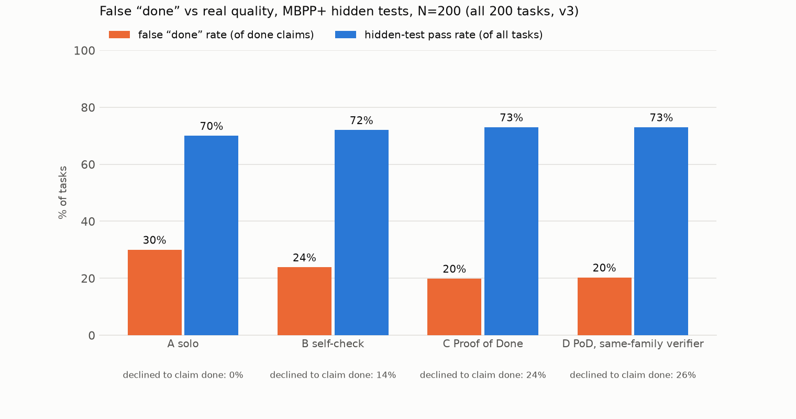

# Results: all 200 tasks, v3

MBPP+ (evalplus), N=200 tasks (seeded order 1-200), seed 17. Agents see only the task prompt; hidden tests = differential testing against `canonical_solution` on base + plus inputs.

- **false done rate** = claimed done AND failed hidden tests / done claims
- **hidden pass** = final code passes hidden tests / all tasks (regardless of claim)
- **not done** = the system declined to claim done (Proof of Done asks the human one question)

| condition | N | done claims | false done | false done rate (95% CI) | hidden pass | not done | calls/task | tokens/task | s/task |
|---|---|---|---|---|---|---|---|---|---|
| A solo | 200 | 200 | 60 | 30.0% (24%–37%) | 70% | 0% | 1.0 | 328 | 1.9 |
| B self-check | 200 | 172 | 41 | 23.8% (18%–31%) | 72% | 14% | 2.5 | 2,922 | 5.8 |
| C Proof of Done | 200 | 151 | 30 | 19.9% (14%–27%) | 73% | 24% | 5.5 | 6,827 | 9.4 |
| D PoD, same-family verifier | 200 | 148 | 30 | 20.3% (15%–27%) | 73% | 26% | 5.6 | 7,087 | 6.3 |

- Proof of Done mutation kill rate: 88% before test strengthening, 95% after (tests strengthened on 56/200 tasks).
- A solo: 70% of tasks ended with a *correct* done claim.
- C Proof of Done: 60% of tasks ended with a *correct* done claim.
- Of the 60 tasks where solo falsely claimed done, Proof of Done **fixed 12** (done + passes hidden tests), **declined 22** (asked the human), and still falsely claimed 26 (25 of those no condition passes).
- Regressions: 9 tasks where solo's code passes hidden tests but Proof of Done's final code does not.

