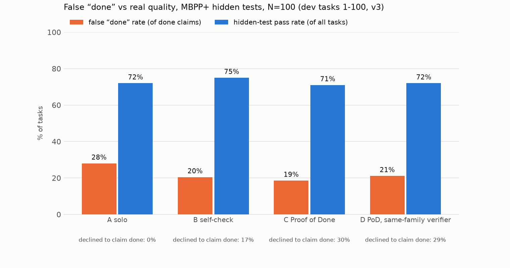

# Results: dev tasks 1-100, v3

MBPP+ (evalplus), N=100 tasks (seeded order 1-100), seed 17. Agents see only the task prompt; hidden tests = differential testing against `canonical_solution` on base + plus inputs.

- **false done rate** = claimed done AND failed hidden tests / done claims
- **hidden pass** = final code passes hidden tests / all tasks (regardless of claim)
- **not done** = the system declined to claim done (Proof of Done asks the human one question)

| condition | N | done claims | false done | false done rate (95% CI) | hidden pass | not done | calls/task | tokens/task | s/task |
|---|---|---|---|---|---|---|---|---|---|
| A solo | 100 | 100 | 28 | 28.0% (20%–37%) | 72% | 0% | 1.0 | 333 | 2.6 |
| B self-check | 100 | 83 | 17 | 20.5% (13%–30%) | 75% | 17% | 2.5 | 3,076 | 6.7 |
| C Proof of Done | 100 | 70 | 13 | 18.6% (11%–29%) | 71% | 30% | 5.5 | 7,077 | 11.2 |
| D PoD, same-family verifier | 100 | 71 | 15 | 21.1% (13%–32%) | 72% | 29% | 5.6 | 7,313 | 6.4 |

- Proof of Done mutation kill rate: 87% before test strengthening, 95% after (tests strengthened on 24/100 tasks).
- A solo: 72% of tasks ended with a *correct* done claim.
- C Proof of Done: 57% of tasks ended with a *correct* done claim.
- Of the 28 tasks where solo falsely claimed done, Proof of Done **fixed 2** (done + passes hidden tests), **declined 13** (asked the human), and still falsely claimed 13 (13 of those no condition passes).
- Regressions: 4 tasks where solo's code passes hidden tests but Proof of Done's final code does not.

