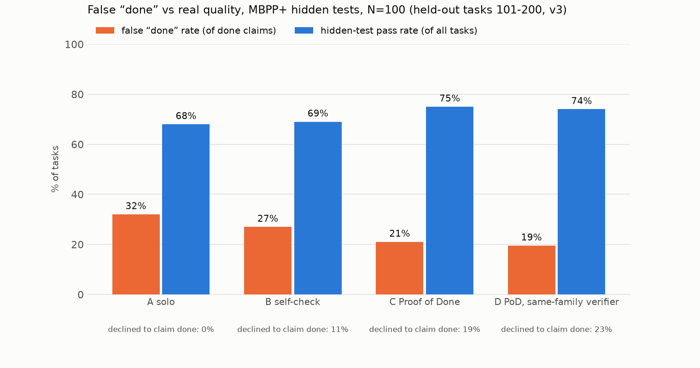

# Results: held-out tasks 101-200, v3

MBPP+ (evalplus), N=100 tasks (seeded order 101-200), seed 17. Agents see only the task prompt; hidden tests = differential testing against `canonical_solution` on base + plus inputs.

- **false done rate** = claimed done AND failed hidden tests / done claims
- **hidden pass** = final code passes hidden tests / all tasks (regardless of claim)
- **not done** = the system declined to claim done (Proof of Done asks the human one question)

| condition | N | done claims | false done | false done rate (95% CI) | hidden pass | not done | calls/task | tokens/task | s/task |
|---|---|---|---|---|---|---|---|---|---|
| A solo | 100 | 100 | 32 | 32.0% (24%–42%) | 68% | 0% | 1.0 | 323 | 1.2 |
| B self-check | 100 | 89 | 24 | 27.0% (19%–37%) | 69% | 11% | 2.5 | 2,768 | 4.8 |
| C Proof of Done | 100 | 81 | 17 | 21.0% (14%–31%) | 75% | 19% | 5.4 | 6,578 | 7.6 |
| D PoD, same-family verifier | 100 | 77 | 15 | 19.5% (12%–30%) | 74% | 23% | 5.6 | 6,861 | 6.2 |

- Proof of Done mutation kill rate: 89% before test strengthening, 96% after (tests strengthened on 32/100 tasks).
- A solo: 68% of tasks ended with a *correct* done claim.
- C Proof of Done: 64% of tasks ended with a *correct* done claim.
- Of the 32 tasks where solo falsely claimed done, Proof of Done **fixed 10** (done + passes hidden tests), **declined 9** (asked the human), and still falsely claimed 13 (12 of those no condition passes).
- Regressions: 5 tasks where solo's code passes hidden tests but Proof of Done's final code does not.

