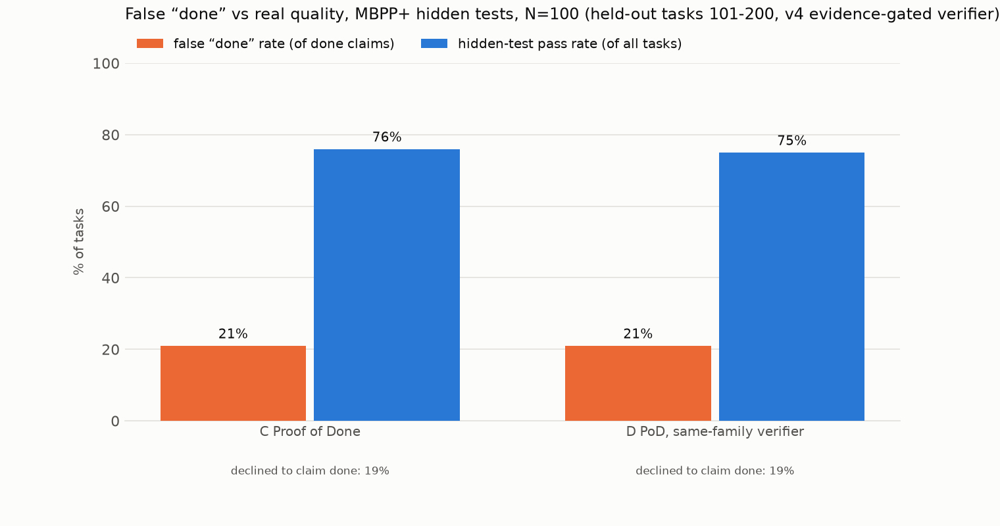

# Results: held-out tasks 101-200, v4 evidence-gated verifier

MBPP+ (evalplus), N=100 tasks (seeded order 101-200), seed 17. Agents see only the task prompt; hidden tests = differential testing against `canonical_solution` on base + plus inputs.

- **false done rate** = claimed done AND failed hidden tests / done claims
- **hidden pass** = final code passes hidden tests / all tasks (regardless of claim)
- **not done** = the system declined to claim done (Proof of Done asks the human one question)

| condition | N | done claims | false done | false done rate (95% CI) | hidden pass | not done | calls/task | tokens/task | s/task |
|---|---|---|---|---|---|---|---|---|---|
| C Proof of Done | 100 | 81 | 17 | 21.0% (14%–31%) | 76% | 19% | 5.3 | 6,526 | 3.6 |
| D PoD, same-family verifier | 100 | 81 | 17 | 21.0% (14%–31%) | 75% | 19% | 5.2 | 6,385 | 3.7 |

- Proof of Done mutation kill rate: 89% before test strengthening, 96% after (tests strengthened on 32/100 tasks).
- C Proof of Done: 64% of tasks ended with a *correct* done claim.

