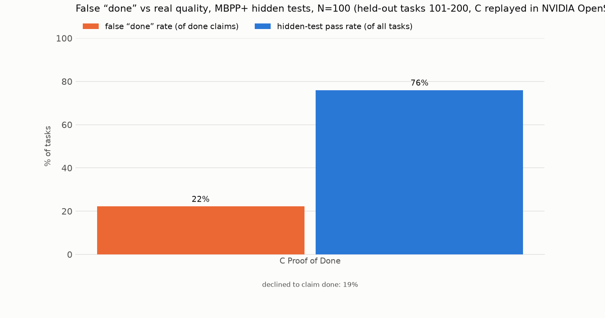

# Results: held-out tasks 101-200, C replayed in NVIDIA OpenShell

MBPP+ (evalplus), N=100 tasks (seeded order 101-200), seed 17. Agents see only the task prompt; hidden tests = differential testing against `canonical_solution` on base + plus inputs.

- **false done rate** = claimed done AND failed hidden tests / done claims
- **hidden pass** = final code passes hidden tests / all tasks (regardless of claim)
- **not done** = the system declined to claim done (Proof of Done asks the human one question)

| condition | N | done claims | false done | false done rate (95% CI) | hidden pass | not done | calls/task | tokens/task | s/task |
|---|---|---|---|---|---|---|---|---|---|
| C Proof of Done | 100 | 81 | 18 | 22.2% (15%–32%) | 76% | 19% | 5.4 | 6,563 | 6.9 |

- Proof of Done mutation kill rate: 89% before test strengthening, 96% after (tests strengthened on 32/100 tasks).
- C Proof of Done: 63% of tasks ended with a *correct* done claim.

- Agreement with the local-sandbox run of condition C on the same 100 tasks: same final status on 98/100, same hidden-test verdict on 99/100.
